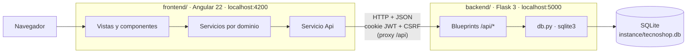
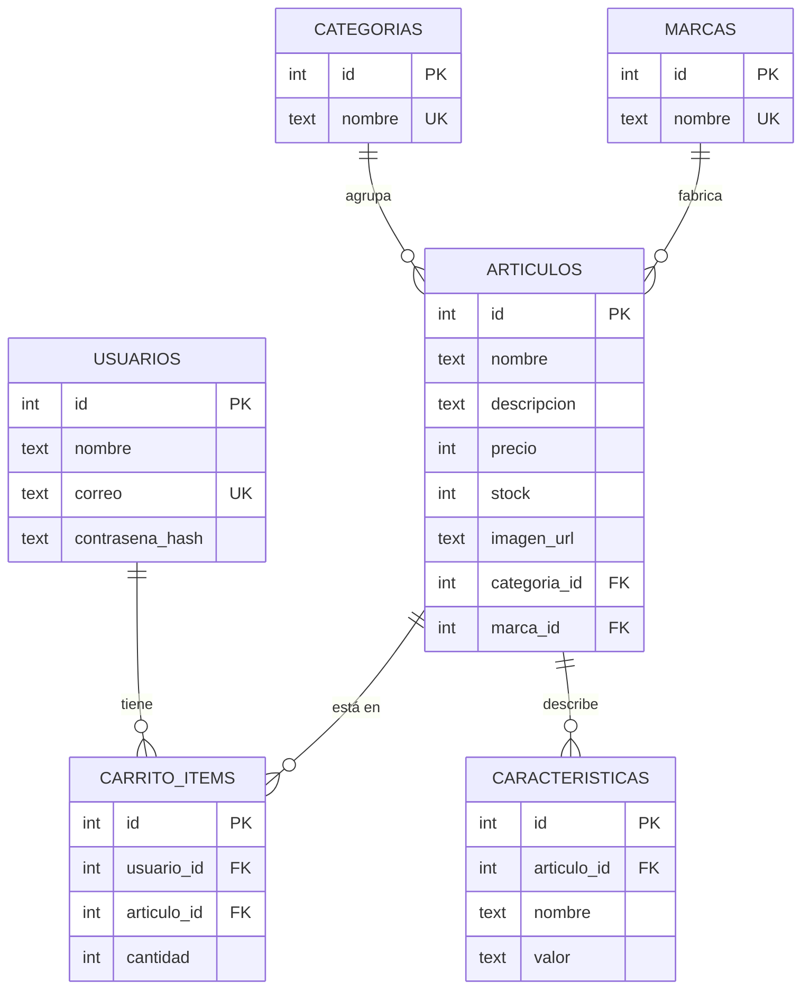
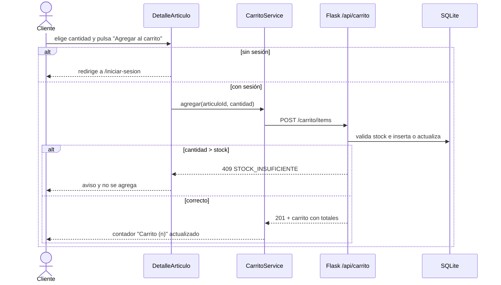

# Documento de diseño · TecnoShop

**Responsable:** Johan Sotomayor (JSO), gerente de desarrollo · **Tarea:** T18 · **Versión:** 1.1 · **Fecha:** 22-11-2026
**Inspección:** Jennyfer Santana (T22) · **Requisitos cubiertos:** R01–R07

Este documento convierte los requisitos R01–R07 del plan en una arquitectura, una lista de componentes y unas convenciones de código. Se complementa con:

- [`docs/wireframes/`](wireframes/README.md): pantallas de baja fidelidad (T21, LC)
- `backend/app/schema.sql`: modelo de datos (T19, JP)
- [`docs/api.md`](api.md): contrato de la API (T20, JP). **Es la fuente de verdad** para rutas, campos y errores; la sección 6 de este documento solo lo resume.

---

## 1. Arquitectura general

Aplicación web de tres capas que se ejecuta localmente:



| Capa | Tecnología | Responsabilidad |
| --- | --- | --- |
| Presentación | Angular 22 (componentes *standalone*, *signals*) | Mostrar el catálogo, capturar búsquedas y filtros, manejar la navegación y mostrar los mensajes de cada criterio de aceptación |
| Lógica | Flask 3 + flask-cors | Validar datos, aplicar las reglas de negocio (stock, sesión, totales) y exponer la API REST en `/api` |
| Datos | SQLite 3 | Guardar usuarios, catálogo y carrito, con integridad (llaves foráneas, `CHECK`, *triggers* de stock) |

### 1.1 Decisiones de arquitectura

| # | Decisión | Justificación |
| --- | --- | --- |
| D1 | El frontend es una SPA y el backend solo devuelve JSON | Cada equipo trabaja en paralelo; la API se prueba sola con Postman y pytest (T17, T51) |
| D2 | Todo el frontend habla con Flask **solo** a través del servicio `Api` | La URL del backend vive en un único lugar (`src/environments/`) |
| D3 | Sesión con **JWT en una cookie `HttpOnly`** (`flask-jwt-extended`) y CSRF por doble envío | Decidido en T20 (`docs/api.md` §2). JavaScript no puede leer el token, y el mismo backend sirve a clientes futuros con `Authorization: Bearer`. En desarrollo Angular usa un proxy (`/api` → `localhost:5000`) para que la cookie CSRF sea del mismo origen |
| D4 | Las reglas críticas se validan **en la API y en la base de datos** | El stock se valida en el endpoint (mensaje para el usuario) y en el *trigger* `STOCK_INSUFICIENTE` (segunda barrera, R05) |
| D5 | Los totales del carrito se calculan en el backend (vistas `v_carrito_detalle` y `v_carrito_resumen`) | Una sola fuente de verdad para R06; el frontend solo muestra los totales |
| D6 | Precios en pesos colombianos como **enteros** | Evita errores de redondeo; el frontend los formatea como `$1.499.000` |
| D7 | Las vistas se cargan de forma diferida (`loadComponent`) | Cada vista es un archivo independiente; menos conflictos de merge entre integrantes |
| D8 | El catálogo se carga por script (seed) y no hay panel de administración | Está fuera del alcance (sección 1.4.2 del plan) |

---

## 2. Frontend (Angular)

### 2.1 Estructura de carpetas

```
frontend/src/app/
├── core/
│   ├── services/        → Api (base), ArticulosService, SesionService, CarritoService
│   ├── guards/          → sesionGuard (rutas que exigen iniciar sesión)
│   └── models/          → interfaces TypeScript: Articulo, Usuario, ItemCarrito…
├── components/          → componentes reutilizables (sin llamadas HTTP)
├── pages/               → una carpeta por vista (las que tienen ruta)
├── app.routes.ts
└── app.ts / app.html    → encabezado + <router-outlet>
```

Regla: **las páginas llaman a los servicios; los componentes reutilizables solo reciben datos (`input`) y emiten eventos (`output`).**

### 2.2 Rutas

| Ruta | Vista | Acceso | Wireframe | Tarea |
| --- | --- | --- | --- | --- |
| `/` | Catálogo con buscador y filtros | Libre | 01, 02 | T32, T45 |
| `/articulo/:id` | Detalle / vista ampliada | Libre | 03, 04 | T27, T47 |
| `/iniciar-sesion` | Inicio de sesión | Libre | 05 | T33 |
| `/registro` | Registro | Libre | 06 | T33 |
| `/carrito` | Carrito de compras | **Con sesión** (`sesionGuard`) | 07, 08 | T46 |

La vista ampliada se muestra como **ventana superpuesta** sobre el catálogo (wireframe 03). Tener su propia ruta permite cerrarla con la ✕ o con el botón *atrás* del navegador, y compartir el enlace de un artículo.

### 2.3 Componentes

| Componente | Tipo | Qué hace | Requisito | Tarea |
| --- | --- | --- | --- | --- |
| `App` (encabezado) | Estructura | Logo, buscador, botón *Iniciar sesión* o nombre del usuario, botón *Carrito (n)* | R01, R02, R06 | T24 |
| `Buscador` | Reutilizable | Caja "Buscar por nombre…"; emite el texto escrito | R02 | T32 |
| `TarjetaArticulo` | Reutilizable | Imagen, categoría · marca, nombre, precio, stock o **"Agotado"**, botón *Ver detalle* | R04, R07 | T27 |
| `PanelFiltros` | Reutilizable | Categoría, marca, precio mín./máx., *Aplicar* y **"Limpiar filtros"** | R03 | T45 |
| `SelectorCantidad` | Reutilizable | Botones − / + con mínimo 1 y máximo igual al stock | R05, R06 | T47 |
| `Catalogo` | Página | Une buscador, filtros y la grilla de tarjetas; muestra "Mostrando n artículos" o **"Sin resultados"** | R02, R03, R07 | T32 |
| `DetalleArticulo` | Página | Vista ampliada con descripción y características; cantidad y *Agregar al carrito*; avisos de stock y de sesión | R04, R05 | T27, T47 |
| `IniciarSesion` | Página | Formulario de correo y contraseña; mensaje **"Correo o contraseña inválidos"** | R01 | T33 |
| `Registro` | Página | Formulario de nombre, correo y contraseña; confirmación o **"Este correo ya tiene una cuenta"** | R01 | T33 |
| `Carrito` | Página | Tabla con cantidad, precio unitario y subtotal; resumen con totales; **"Tu carrito está vacío"** | R06 | T46 |

### 2.4 Servicios

| Servicio | Responsabilidad | Endpoints que usa |
| --- | --- | --- |
| `Api` (ya existe, T24) | Antepone `environment.apiUrl` (`/api`) y envía las cookies (`withCredentials`) | Todos |
| `ArticulosService` | Listar, buscar, filtrar y consultar el detalle; opciones de filtros | `/articulos`, `/categorias`, `/marcas` |
| `SesionService` | Registro, inicio y cierre de sesión. Guarda el usuario actual en un `signal` que lee el encabezado | `/auth/*` |
| `CarritoService` | Agregar, cambiar cantidad, eliminar. Guarda el carrito y los totales en `signals` para el contador del encabezado | `/carrito/*` |

**Estado:** con `signal` y `computed` dentro de los servicios. No se usa NgRx ni otra librería de estado.

### 2.5 Manejo de sesión en el frontend

1. Al arrancar, `SesionService` llama a `GET /api/auth/me` para saber si ya hay sesión iniciada (la cookie sigue viva tras recargar la página).
2. `sesionGuard` protege `/carrito`: sin sesión, redirige a `/iniciar-sesion?volver=/carrito`.
3. En el detalle, *Agregar al carrito* sin sesión lleva al inicio de sesión (R05) y, tras iniciar sesión, devuelve al artículo.
4. Si la API responde `401` fuera de `/auth/*` (por ejemplo, el token venció tras 1 hora), `sesionVencidaInterceptor` limpia el usuario y envía al inicio de sesión.
5. CSRF: `withXsrfConfiguration` copia la cookie `csrf_access_token` en el encabezado `X-CSRF-TOKEN` en cada `POST`, `PUT` y `DELETE`.

---

## 3. Backend (Flask)

### 3.1 Estructura

```
backend/
├── app/
│   ├── __init__.py      → create_app(): configuración, CORS, registro de blueprints
│   ├── db.py            → get_db(), init_db(), comando `flask --app app init-db`
│   ├── errores.py       → formato único de error {error: {codigo, mensaje}}
│   ├── seguridad.py     → configuración de JWT y CSRF            (T31)
│   ├── schema.sql       → tablas, vistas, triggers y categorías base
│   └── routes/
│       ├── salud.py     → GET /api/salud                  (T25, ya existe)
│       ├── articulos.py → catálogo, búsqueda y filtros     (T30, T42)
│       ├── auth.py      → registro, inicio y cierre sesión (T31)
│       └── carrito.py   → carrito y totales                (T43)
├── tests/               → pytest: un archivo por blueprint (T51)
└── requirements.txt
```

Cada archivo de `routes/` es un **Blueprint** con `url_prefix="/api"`, igual que `salud.py`.

### 3.2 Reglas de implementación

- Contraseñas con `werkzeug.security.generate_password_hash` / `check_password_hash` (columna `contrasena_hash`). Nunca en texto plano ni en las respuestas.
- Consultas SQL **siempre parametrizadas** (`?`), nunca armadas con *f-strings*.
- La búsqueda por nombre no distingue mayúsculas ni tildes: `normalizar(nombre) LIKE ?` con `%texto%` (R02).
- Ninguna ruta recibe `usuario_id`: el usuario sale **siempre del token** (`get_jwt_identity()`). Sin sesión responden `401 NO_AUTENTICADO`.
- Los errores se devuelven con el formato de `docs/api.md` §1 para que el frontend muestre el texto exacto del criterio de aceptación.

---

## 4. Modelo de datos

Definido en `backend/app/schema.sql` (T19). Resumen:



| Objeto | Uso |
| --- | --- |
| Vista `v_articulos` | Catálogo con nombre de categoría y marca, y la bandera `agotado` (R04) |
| Vista `v_carrito_detalle` | Precio unitario y subtotal por línea (R06) |
| Vista `v_carrito_resumen` | Total de artículos y total a pagar por usuario (R06) |
| *Triggers* `trg_carrito_stock_*` | Impiden que la cantidad supere el stock (R05) |
| `UNIQUE (usuario_id, articulo_id)` | Agregar un artículo que ya está en el carrito actualiza la cantidad |

---

## 5. Flujos principales

### 5.1 Búsqueda y filtros (R02, R03)

1. El usuario escribe en el buscador o aplica filtros.
2. `Catalogo` llama a `ArticulosService.buscar({ q, categoria_id, marca_id, precio_min, precio_max })`.
3. La API responde la lista filtrada. Si está vacía, la vista muestra **"Sin resultados"**.
4. **"Limpiar filtros"** borra los parámetros y vuelve a pedir el catálogo completo. Con la búsqueda vacía también se muestra todo.

### 5.2 Agregar al carrito (R05)



### 5.3 Registro e inicio de sesión (R01)

- **Registro:** `POST /auth/registro`. Si sale bien (`201`) se muestra un texto de confirmación; si el correo ya existe (`409`) se muestra **"Este correo ya tiene una cuenta"**.
- **Inicio de sesión:** `POST /auth/login`. Si sale bien (`200`), el encabezado muestra el nombre del cliente; si no (`401`), **"Correo o contraseña inválidos"**.

---

## 6. API

El contrato completo está en [`docs/api.md`](api.md) (T20, JP). Resumen de lo que más afecta al frontend:

| Tema | Acuerdo |
| --- | --- |
| Base | `/api` (en desarrollo, el proxy de Angular la reenvía a `http://localhost:5000`) |
| Respuestas correctas | El recurso directamente (objeto o lista). Sin coincidencias: `200` con `[]` |
| Errores | `{ "error": { "codigo": "CORREO_EXISTE", "mensaje": "Este correo ya tiene una cuenta" } }`; el `mensaje` es el texto exacto del criterio de aceptación |
| Artículo | `marca` y `categoria` llegan como objetos `{ id, nombre }`; `descripcion` solo en el detalle. `ArticulosService` los aplana para las plantillas |
| Filtros | `q`, `categoria_id`, `marca_id`, `precio_min`, `precio_max` |
| Sesión | `POST /auth/registro`, `POST /auth/login`, `POST /auth/logout`, `GET /auth/me` |
| Carrito | Toda ruta responde el carrito completo y recalculado (`items`, `total_articulos`, `total_pagar`) |

---

## 7. Trazabilidad

| Req. | Vistas y componentes | Endpoints | Datos |
| --- | --- | --- | --- |
| R01 | `Registro`, `IniciarSesion`, encabezado | `/auth/*` | `usuarios` |
| R02 | `Buscador`, `Catalogo` | `GET /articulos?q=` | `articulos` (índice por nombre) |
| R03 | `PanelFiltros`, `Catalogo` | `GET /articulos?…`, `/categorias`, `/marcas` | `categorias`, `marcas`, índices de precio |
| R04 | `TarjetaArticulo`, `DetalleArticulo` | `GET /articulos/<id>` | `v_articulos`, `caracteristicas` |
| R05 | `SelectorCantidad`, `DetalleArticulo`, `sesionGuard` | `POST /carrito/items` | `carrito_items` + *trigger* de stock |
| R06 | `Carrito`, `SelectorCantidad` | `GET/PUT/DELETE /carrito…` | `v_carrito_detalle`, `v_carrito_resumen` |
| R07 | `Catalogo`, `TarjetaArticulo` | `GET /articulos` | Seed de 20 o más artículos (T26, T29) |

---

## 8. Convenciones de código

**Generales**
- Nombres de dominio en **español** y sin tildes en el código (`articulo`, `precio`, `contrasena`). Los textos visibles para el usuario sí llevan tildes.
- Ramas, commits y PR según [`docs/guia-repositorio.md`](guia-repositorio.md).

**Angular**
- Generar con la CLI: `npx ng g c pages/nombre` o `npx ng g c components/nombre`. Archivos en *kebab-case* y clases en *PascalCase* sin sufijo (`TarjetaArticulo`), que es el estilo de Angular 22.
- Componentes *standalone*, `inject()` en lugar de constructores y `signal`/`computed` para el estado.
- Control de flujo nuevo en las plantillas (`@if`, `@for`) en lugar de `*ngIf` y `*ngFor`.
- Formularios con *Reactive Forms*.
- Precios con el *pipe* `currency` (`'COP'`, `'symbol-narrow'`, `'1.0-0'`) para mostrar `$1.499.000`.
- Formato con Prettier (`.prettierrc` incluido en el proyecto).

**Flask**
- PEP 8, funciones y variables en *snake_case*, un Blueprint por dominio.
- Claves JSON en *snake_case* (`imagen_url`, `precio_unitario`); el frontend usa esos mismos nombres en sus interfaces.
- Cada endpoint nuevo llega con al menos una prueba en `backend/tests/`.

---

## 9. Puntos para la inspección (T22)

1. **Botón "Confirmar pedido"** (wireframe 07): la confirmación del pedido está **fuera del alcance** (plan 1.4.2). Propuesta: quitarlo o dejarlo deshabilitado con el texto "Próximamente".
2. **Paleta de colores:** pendiente la votación entre A (Azul Glaciar) y B (Índigo Menta), según el archivo de Figma. Se aplica en T49.
3. **Puerto del backend:** se usa el `5000` (el de Flask por defecto). En algunos equipos Windows ese puerto ya está ocupado por el sistema; en ese caso se corre Flask con `--port 5001` y se ajusta `target` en `frontend/proxy.conf.json`.
4. **Imágenes:** el seed usa URLs externas en `imagen_url`, y el repositorio también trae la carpeta `backend/IMAGENES TECNOSHOP/`. Hay que decidir una sola fuente para cumplir con "sin imágenes rotas" (R07). Propuesta: servir las imágenes locales desde Flask (`/static/articulos/…`) con nombres sin espacios.

## Historial

| Versión | Fecha | Cambio | Autor |
| --- | --- | --- | --- |
| 1.0 | 21-11-2026 | Versión inicial | JSO |
| 1.1 | 22-11-2026 | Alinea sesión (D3), sección 6 y flujos con el contrato de T20 (`docs/api.md`) | JSO |
